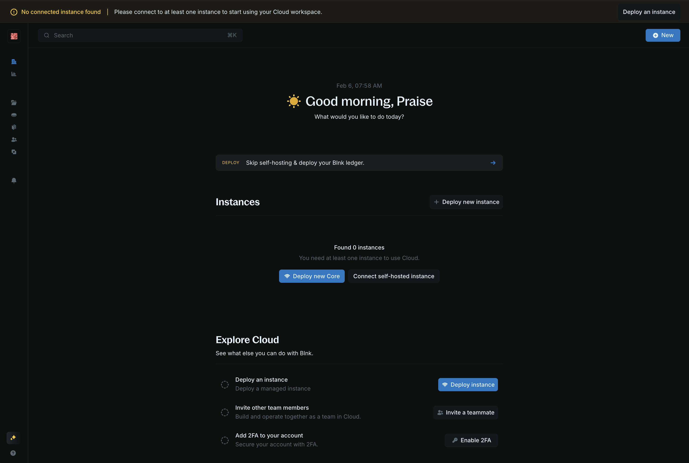
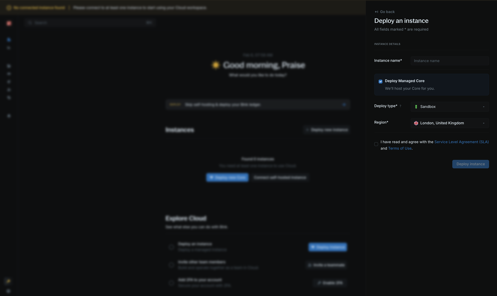
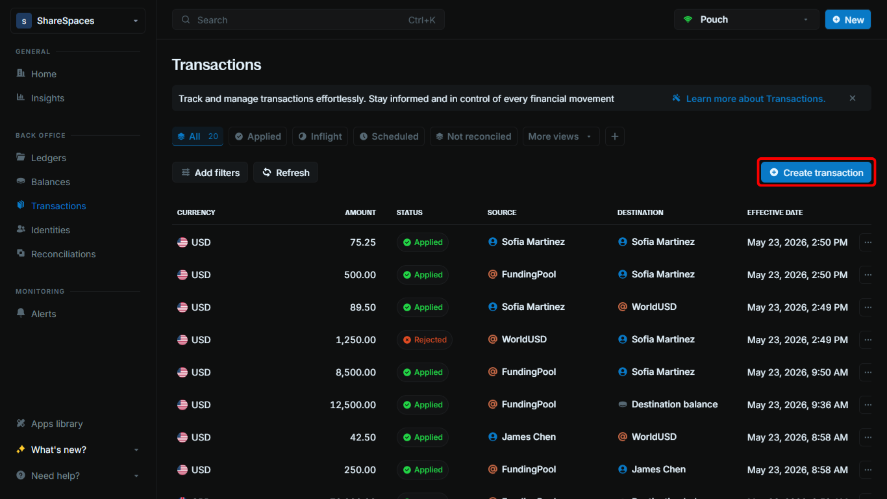
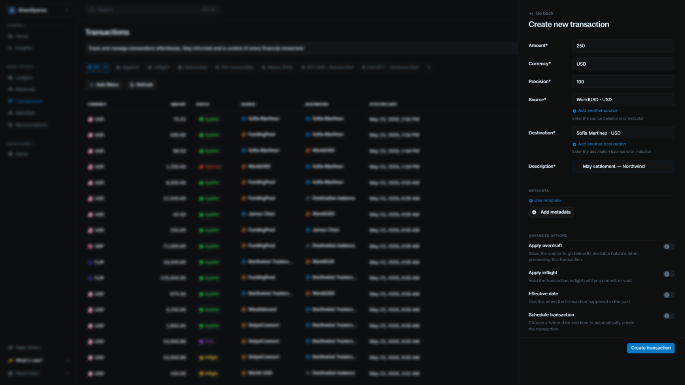
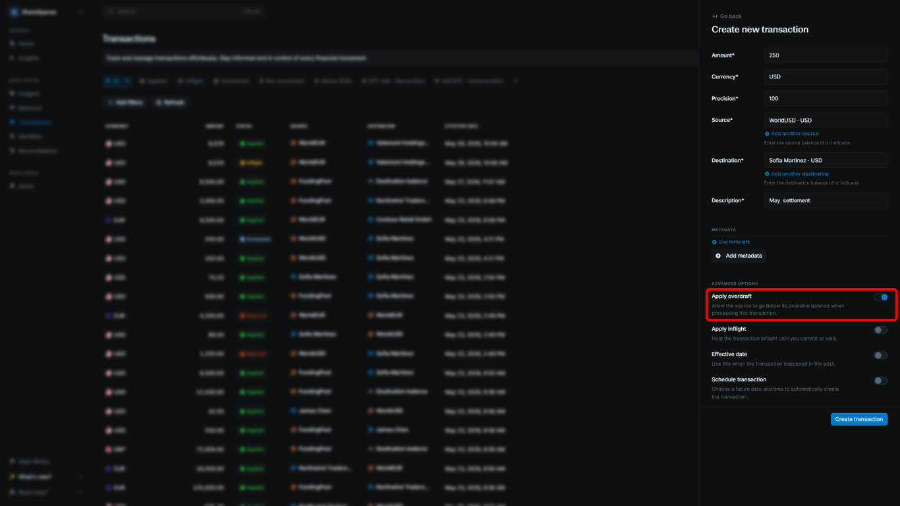

Blnk is an open source, double-entry ledger for building financial products.

It is very simple to set up, and it takes less than 5 minutes to start using for your product.

## Install Blnk

<Tabs>
<Tab title="On your machine">

This runs Blnk on your computer. You need [Docker](https://www.docker.com/) and [Compose](https://docs.docker.com/compose/).

<Steps titleSize="h3">
<Step title="Start Blnk">

Clone the repository, then start the server:

```bash bash
git clone https://github.com/blnkfinance/blnk && cd blnk
docker compose up
```

You'll find your Blnk instance running at `http://localhost:5001`.

</Step>
</Steps>

</Tab>

<Tab title="Using Blnk Cloud">

Instead of self-hosting, start with a sandbox on Blnk Cloud.

<Steps titleSize="h3">
<Step title="Deploy a Core">

Sign up at [cloud.blnkfinance.com](https://cloud.blnkfinance.com/?utm_source=blnk_docs&utm_medium=documentation&utm_campaign=home%2Finstall), then click **Deploy new Core** on the homepage.



</Step>

<Step title="Name the instance">

Choose a name, then click **Deploy managed Core**.



</Step>

<Step title="Wait until it is connected">

Deployment takes about 7–10 minutes. When the status is **Connected**, open the instance to copy the Core URL and secret key.

</Step>
</Steps>

</Tab>
</Tabs>

## Record your first transaction

Let's record a \$1,000.00 transaction between two balances. 

We'll use [internal balances](/balances/internal-balances) so that the balances are auto-created when we record the transaction.

<Tabs>
<Tab title="Using API">

<Steps titleSize="h3">
<Step title="Post the transaction">

Send this request to `http://localhost:5001` on your machine. 

If using Blnk Cloud, use the Core URL from your instance and send your secret key as `X-blnk-key`.

<CodeGroup>
```bash cURL wrap
curl -X POST 'http://localhost:5001/transactions' \
  -H 'X-blnk-key: <api-key>' \
  -H 'Content-Type: application/json' \
  -d '{
    "precise_amount": 100000,
    "reference": "first_transaction_001",
    "currency": "USD",
    "precision": 100,
    "source": "@FundingPool",
    "destination": "@MyBalance",
    "description": "My first Blnk transaction",
    "allow_overdraft": true,
    "skip_queue": true,
    "meta_data": {}
  }'
```

```typescript TypeScript wrap
const response = await blnk.Transactions.create({
  precise_amount: 100000,
  reference: 'first_transaction_001',
  currency: 'USD',
  precision: 100,
  source: '@FundingPool',
  destination: '@MyBalance',
  description: 'My first Blnk transaction',
  allow_overdraft: true,
  skip_queue: true,
  meta_data: {},
});
```

```go Go wrap
transaction, resp, err := client.Transaction.Create(blnkgo.CreateTransactionRequest{
    ParentTransaction: blnkgo.ParentTransaction{
        PreciseAmount: big.NewInt(100000),
        Reference: "first_transaction_001",
        Currency: "USD",
        Precision: 100,
        Source: "@FundingPool",
        Destination: "@MyBalance",
        Description: "My first Blnk transaction",
        SkipQueue: true,
    },
    AllowOverdraft: true,
})
```

```python Python wrap
response = blnk.transactions.create({
  "precise_amount": 100000,
  "reference": "first_transaction_001",
  "currency": "USD",
  "precision": 100,
  "source": "@FundingPool",
  "destination": "@MyBalance",
  "description": "My first Blnk transaction",
  "allow_overdraft": True,
  "skip_queue": True,
  "meta_data": {},
})
```

```java Java wrap
ApiResponse<JsonNode> response = blnk.transactions().create(
    CreateTransactions.create()
        .preciseAmount(100000)
        .reference("first_transaction_001")
        .currency("USD")
        .precision(100)
        .source("@FundingPool")
        .destination("@MyBalance")
        .description("My first Blnk transaction")
        .allowOverdraft(true)
        .skipQueue(true)
        .metaData(Map.of()));
```
</CodeGroup>

</Step>

<Step title="Read the response">

```json 201 Created
{
  "id": "txn_6164573b-6cc8-45a4-ad2e-7b4ba6a60f7d",
  "source": "@FundingPool",
  "destination": "@MyBalance",
  "reference": "first_transaction_001",
  "amount": 1000,
  "precision": 100,
  "precise_amount": 100000,
  "currency": "USD",
  "description": "My first Blnk transaction",
  "allow_overdraft": true,
  "status": "APPLIED",
  "created_at": "2024-12-21T01:36:46.997063436Z",
  "meta_data": {}
}
```

`precise_amount` is 100000 and `precision` is 100, so the amount is 1,000.00 USD.

The transaction is recorded. `status` is `APPLIED`, and the balances should have been updated with their correct amounts.

</Step>
</Steps>

</Tab>

<Tab title="Using the Dashboard">

In your Blnk Cloud workspace, open **Transactions**.

<Steps titleSize="h3">
<Step title="Open Create transaction">

Click **Create transaction** in the top right. You can also press `⌥ T` (`Alt+T` on Windows).



</Step>

<Step title="Enter the transaction">

Fill in the form:

- **Amount:** `1000`
- **Currency:** `USD`
- **Precision:** `100`
- **Source:** `@FundingPool`
- **Destination:** `@MyBalance`
- **Description:** `My first Blnk transaction`



</Step>

<Step title="Allow the funding pool to go negative">

Under **Advanced options**, turn on **Apply overdraft**. `@FundingPool` has no funds yet, so the transaction needs this.



</Step>

<Step title="Create the transaction">

Click **Create transaction**. The new row shows in the Transactions table.

The transaction is recorded. Source is `@FundingPool` and destination is `@MyBalance`.

</Step>
</Steps>

</Tab>
</Tabs>

<RelatedTopics
  items={[
    { title: "Ledgers", href: "/ledgers/introduction" },
    { title: "Balances", href: "/balances/introduction" },
    { title: "Transactions", href: "/transactions/introduction" },
    { title: "Identities", href: "/identities/introduction" },
  ]}
/>
